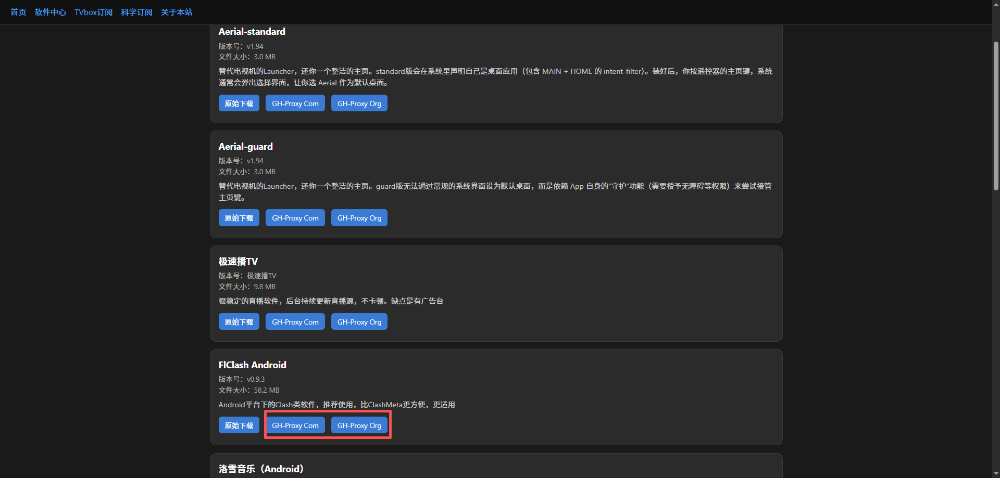
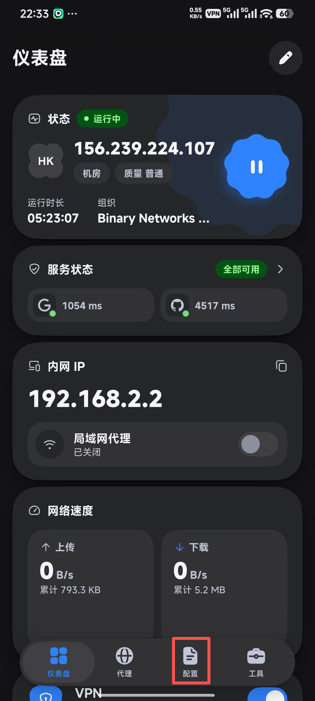
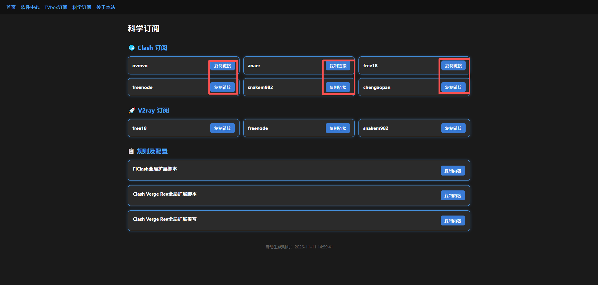
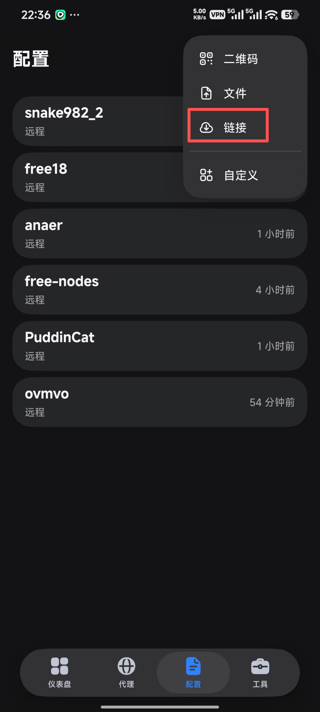
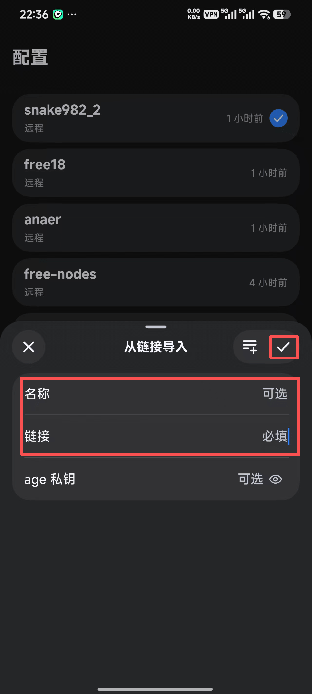
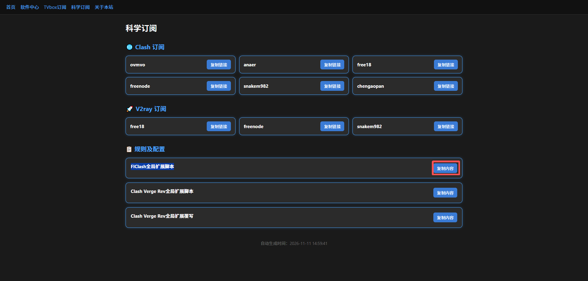
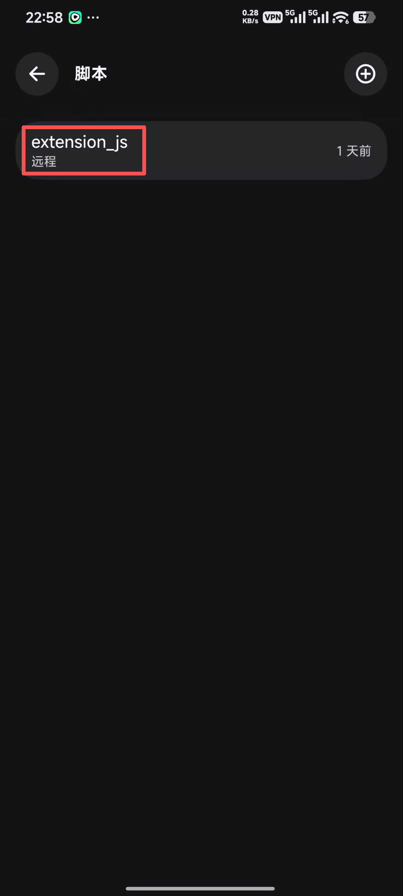
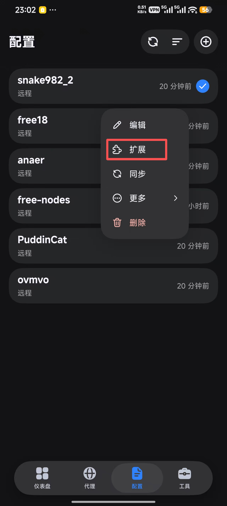
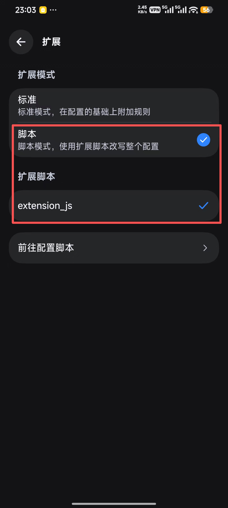
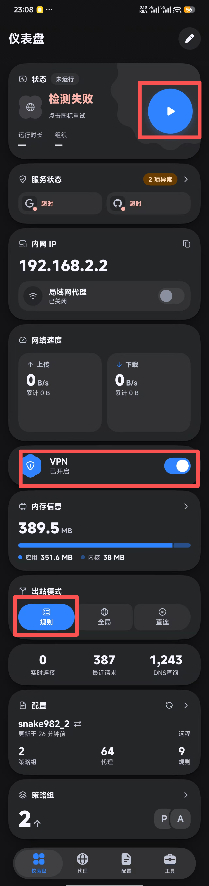

# FlClash 使用说明（Android）

本文介绍如何在 Android 手机/平板上安装 **FlClash**，并从本站导入 Clash 订阅与全局扩展脚本。

> 建议使用较新的 Android 系统，并允许安装未知来源应用。

---

## 1. 安装 FlClash

打开软件中心页面：

[https://child9527.github.io/software/](https://child9527.github.io/software/)

找到 **FlClash Android**，点击任意下载按钮（**原始下载** / **GH-Proxy Com** / **GH-Proxy Org**）下载 APK 并安装；推荐选择**GH-Proxy Org**；在没有梯子的情况下，无法直接访问github，切勿选择**原始下载**。

---

## 2. 打开「配置」页

安装完成后打开 FlClash，在底部导航栏点击 **配置**。

---

## 3. 复制 Clash 订阅链接

打开科学订阅页面：

[https://child9527.github.io/proxy/](https://child9527.github.io/proxy/)

在 **Clash 订阅** 区域，任选一个订阅并点击 **复制链接**（推荐 `snakem982`）。

---

## 4. 从链接导入订阅

回到 FlClash **配置** 页：

1. 点击右上角 **+**
2. 选择 **链接**

在弹出窗口中：

- **名称**：可选，可填 `snakem982` 等便于识别的名字
- **链接**：粘贴上一步复制的订阅 URL（必填）

然后点击右上角 **✔** 保存。

---

## 5. 复制 FlClash 全局扩展脚本

再次打开科学订阅页面，在 **规则及配置** 中找到 **FlClash全局扩展脚本**，点击 **复制内容**。

---

## 6. 添加扩展脚本

在 FlClash 中进入：**工具 → 进阶配置 → 脚本**。

1. 点击右上角 **+**，选择「从零开始」（或新建脚本）
2. 删除编辑框中的所有默认内容
3. 粘贴刚才复制的脚本全文并保存
4. 按提示为脚本命名（示例：`extension_js`）

保存后脚本会出现在列表中。按本步骤操作一般为「本地」；若使用远程链接则会显示为「远程」。

---

## 7. 为订阅启用扩展脚本

回到 **配置** 页，**长按** 刚导入的订阅（例如 `snake982_2`），在弹出菜单中选择 **扩展**。

在扩展设置中：

1. 扩展模式选择 **脚本**（使用扩展脚本改写整个配置）
2. 在扩展脚本列表中勾选你在上一步创建的脚本（如 `extension_js`）

---

## 8. 启动代理

打开 **仪表盘**：

1. **出站模式** 选择 **规则**
2. 打开底部 **VPN** 开关
3. 点击顶部的 **运行** 按钮

看到运行状态正常后即可开始使用。

---

## 常见问题

- **无法安装 APK**：请在系统设置中允许「安装未知应用」。
- **订阅导入失败**：检查网络，或改用页面上的镜像订阅链接后重试。
- **连接异常 / 检测失败**：确认已启用扩展脚本、出站模式为「规则」，并尝试切换其他订阅源。
- **脚本不生效**：回到订阅的「扩展」设置，确认脚本模式已选中且对应脚本已勾选。

---

*说明文档随站点维护；订阅与脚本内容由本站自动更新。*
